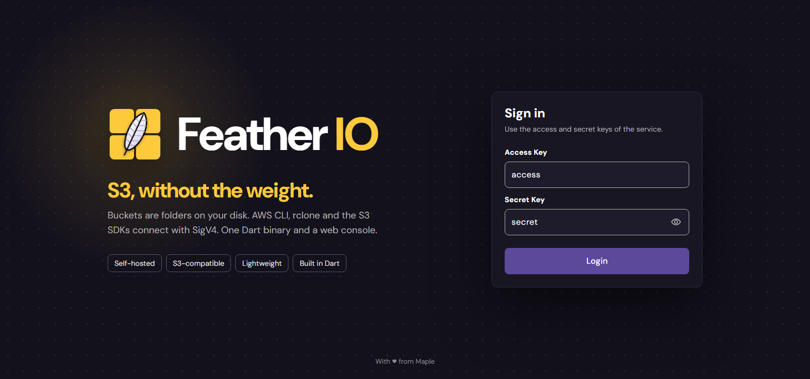
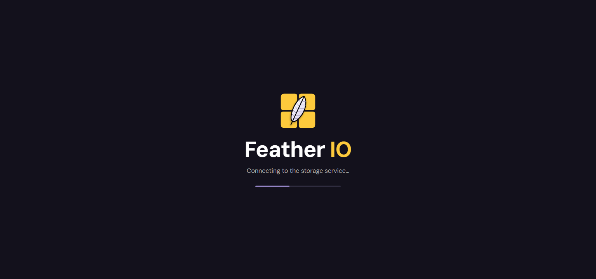
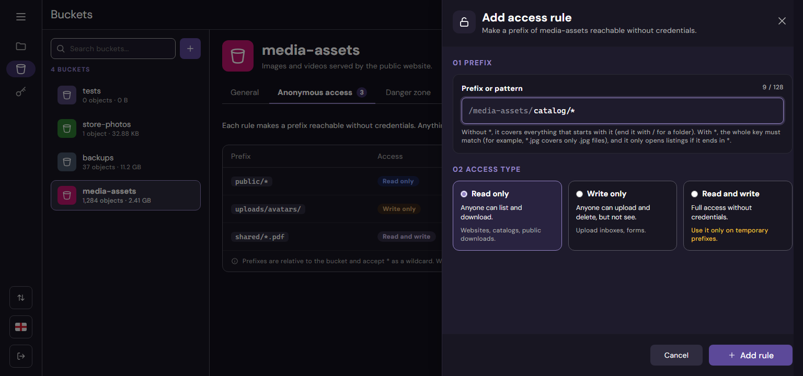

# The console

A tour of the Feather IO web console: each screen, its URL and what it does. The images come from
the design of the console ([`design/`](design/README.md)); the console itself speaks English and
Spanish (the selector in the rail).

URLs are relative to where the console is served (`http://localhost:8081` by default). The console
uses hash URLs, so the screen and its state go after `#`:
`http://localhost:8081/#/browser?bucket=photos`.
Screens whose state is worth sharing keep it in the URL, so a link opens the same bucket, folder,
view or tab.

Each screen ends with **Behind it**: the calls it makes to the service, explained with examples in
[`api.md`](api.md). The console talks to the service only through them, with the token of the login
and `Accept: application/json`.

## Configuration and login



**URL:** `/#/login` (with `?from=` the page asked for before logging in, opened again afterwards)

The console only needs to know where the service is. It reads it from `window.env`, in `web/env.js`
locally or from the environment of its Docker image:

| Variable       | Default                 | What it is                                                                                                                                        |
|----------------|-------------------------|---------------------------------------------------------------------------------------------------------------------------------------------------|
| `SERVICE_URL`  | `http://localhost:8080` | The service **as the browser sees it**: the console calls it from the browser, not from its container. Behind a domain or a proxy, its public URL |
| `ADMIN_PREFIX` | `_admin`                | Prefix of the admin API; it must match the service's                                                                                              |

```bash
docker run -p 8081:80 -e SERVICE_URL=https://s3.example.com -e ADMIN_PREFIX=_admin feather-io-console
```

The screen shows the brand (icon, tagline, what the service is and its tags) next to the form; in a
window narrower than 1200 px the brand goes above it, without the description.

You log in with the **root key** of the service: *Access key* is its `FEATHER_ACCESS` and *Secret
key* its `FEATHER_SECRET`. Access keys created in the console are for S3 clients and can't log in.
The service answers with a token valid for 12 hours, which the console keeps across reloads; the
keys typed are never stored by the console (the browser's password manager may offer to save them).
After 10 wrong attempts in a row the service locks the IP for 15 minutes.

**Behind it:** [`POST /_admin/login`](api.md#log-in) with `{"access", "secret"}`, which answers the
token (`access_token`) that every other call sends as `Authorization: Bearer …`. Log out only forgets
it.

While it starts, the console shows a splash:



## Navigation


The rail on the left opens the three sections: **Browser** (`/#/browser`), **Buckets**
(`/#/buckets`) and **Access keys** (`/#/keys`). At its foot: the **transfers** indicator (with
the progress of the uploads and downloads in course), the **language** and **log out**. The menu
button expands it to show the names.

**Behind it:** the transfers are the uploads and downloads described in each section; the language
is also sent to the service (`Accept-Language`), so its error messages come in the same language.

## Browser: the buckets


**URL:** `/#/browser` (`?view_type=list` or `grid`)

The start page. It shows the totals (buckets, objects, storage) and the list of buckets, which can
be searched and seen as a list or as cards. Opening a bucket enters it.


The menu of each bucket opens its settings (in *Buckets*), edits it or deletes it.

**Create bucket** opens a drawer: the name is checked as you type against the S3 rules (3 to 63
characters, lowercase letters, numbers and hyphens, no hyphen at the ends), with an optional
description and a color for the console.

**Behind it:** [`GET /`](api.md#list-buckets) lists the buckets with their statistics (the totals add them
up), [`PUT /{bucket}`](api.md#create-a-bucket) with `{"description", "color"}` creates one, and
[`DELETE /{bucket}`](api.md#delete-a-bucket) deletes it.

|                                                       |                                                               |
|-------------------------------------------------------|---------------------------------------------------------------|
|  |  |
|    |                                                               |

## Browser: inside a bucket


**URL:** `/#/browser?bucket=<bucket>&folder=<folder>&view_type=list` (`folder` without a trailing
`/`, e.g. `photos/2026`; without it, the root of the bucket)

The objects and folders of the current folder, with the path as breadcrumbs, back and forward,
refresh, **New folder** and **Upload**. Objects are paged (25, 50, 75 or 100 per page); the search
and the filters look at the pages already loaded.


The menu of an object opens its details, shares it, renames it, moves it, downloads it or deletes
it:


Selecting several objects enables downloading them (as a zip), moving them or deleting them:


|                                                   |                                                                                             |
|---------------------------------------------------|---------------------------------------------------------------------------------------------|
|  |                                        |
| **Filters** by type, size and date                | **Drag & drop** files onto the list to upload them                                          |
|    |                                             |
| **Delete** asks for confirmation                  | **Details**: preview, key, type, size, date and URL                                         |
|    |                                                      |
| **New folder**                                    | **Rename** (copy and delete, like S3)                                                       |
|                |                                                   |
| **Move** to another folder of the bucket          | **Share link**: a presigned URL for 1 hour, 1 day or 7 days, which works without logging in |

**Preview** opens the object in a new tab: images, video, audio and PDFs as they are; text, HTML,
SVG and other markup as plain text (an uploaded page must not run inside the console); anything
else is downloaded.

**Behind it:**

| Action                           | Call                                                                                                           |
|----------------------------------|----------------------------------------------------------------------------------------------------------------|
| List a folder, page by page      | [`GET /{bucket}?prefix=<folder>/&delimiter=/&max-keys=<n>`](api.md#list-objects), then `&continuation-token=…` |
| Upload a file                    | [`PUT /{bucket}/{key}`](api.md#upload), or [multipart](api.md#multipart-upload) over 16 MiB                    |
| New folder                       | [`PUT /{bucket}/{folder}/`](api.md#upload) without a body                                                      |
| Details                          | [`HEAD /{bucket}/{key}`](api.md#download), and `GET` for the preview                                           |
| Download one object              | [`GET /{bucket}/{key}`](api.md#download)                                                                       |
| Download several, or a folder    | [`POST /_admin/bucket/{bucket}/download`](api.md#download-as-a-zip) (a zip)                                    |
| Rename, move                     | [`PUT /{bucket}/{new key}` with `x-amz-copy-source`](api.md#copy-rename-and-move), then delete the old key     |
| Delete objects                   | [`POST /{bucket}?delete`](api.md#delete-many)                                                                  |
| Delete a folder with its content | [`DELETE /_admin/bucket/{bucket}/folder?prefix=<folder>/`](api.md#delete-a-folder-with-its-content)            |
| Share link                       | [`POST /_admin/bucket/{bucket}/presign`](api.md#presigned-url)                                                 |

### Transfers


Uploads and downloads run in the background: they keep going while you move between folders,
buckets and sections, 2 uploads and 2 downloads at a time. The indicator in the rail shows the
overall progress; its panel lists each file with its progress, and lets you cancel, retry or clear
the finished ones. Files over 16 MiB are uploaded in parts. Closing the tab with transfers running
asks first.

**Behind it:** uploads are [`PUT /{bucket}/{key}`](api.md#upload), or for big files the
[multipart upload](api.md#multipart-upload) (start, 8 MiB parts one after another, complete; a
cancelled or failed upload is aborted). Zip downloads are
[`POST /_admin/bucket/{bucket}/download`](api.md#download-as-a-zip).

## Buckets


**URL:** `/#/buckets?bucket=<bucket>&tab=general` (`tab`: `general`, `access` or `danger`)

The list of buckets on the left and the details of the selected one: name, S3 path, description,
color, number of objects, size and dates. **Open in browser** enters it; **Edit** changes its
description and color.


**Behind it:** [`GET /`](api.md#list-buckets) for the list, [`GET /_admin/bucket/{bucket}`](api.md#details-and-statistics)
for the details and [`PUT /_admin/bucket/{bucket}`](api.md#edit-description-and-color) to edit it.

### Anonymous access


Rules that open part of a bucket to requests without credentials: read only (list and download),
write only (upload and delete) or both. A rule without `*` is a prefix (`public/`, everything
below it); with `*` the whole key must match the pattern (`photos/*.jpg`), and it only opens
listings if it ends in `*` (a listing shows every key under its prefix).



**Behind it:** [`GET`, `POST` and `DELETE /_admin/bucket/{bucket}/anonymous-access`](api.md#anonymous-access)
to list, add and delete the rules.

### Danger zone


**Empty** deletes every object and keeps the bucket, its settings and its rules; it asks you to type
the name of the bucket. **Delete** removes the bucket with its description, color and rules; as in
S3, only when it is empty.


**Behind it:** [`DELETE /_admin/bucket/{bucket}/objects`](api.md#empty-a-bucket) to empty it and
[`DELETE /{bucket}`](api.md#delete-a-bucket) to delete it.

## Access keys


**URL:** `/#/keys`

The keys S3 clients (AWS CLI, rclone, SDKs) sign with, besides the root key of the service: their
id, permissions, last use and state (active, disabled, expired). The root key is listed first and
can't be changed here. Each key's menu edits its permissions, disables or enables it, regenerates
its secret or deletes it.


A key gets a name, an optional expiry, and either one level on every bucket (current and future,
and only then it can create and delete buckets) or a level per bucket: read, write or both.


The secret is shown **once**, when the key is created or its secret regenerated; the dialog can't be
closed until you confirm you saved it (it can also be downloaded as a `.csv`).


**Behind it:** [`GET /_admin/access-keys`](api.md#access-keys) for the list (and
[`GET /`](api.md#list-buckets) for the buckets of the form),
[`POST /_admin/access-keys`](api.md#create-a-key) to create one,
[`PUT /_admin/access-keys/{id}`](api.md#update-a-key) to edit, enable or disable it,
[`POST /_admin/access-keys/{id}/secret`](api.md#regenerate-the-secret) for a new secret and
[`DELETE /_admin/access-keys/{id}`](api.md#delete-a-key) to delete it.
